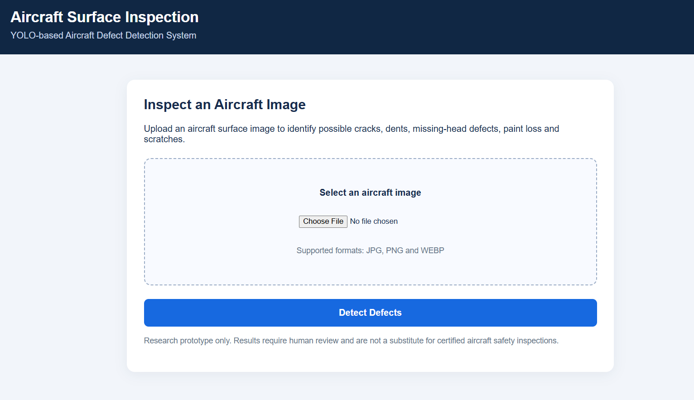
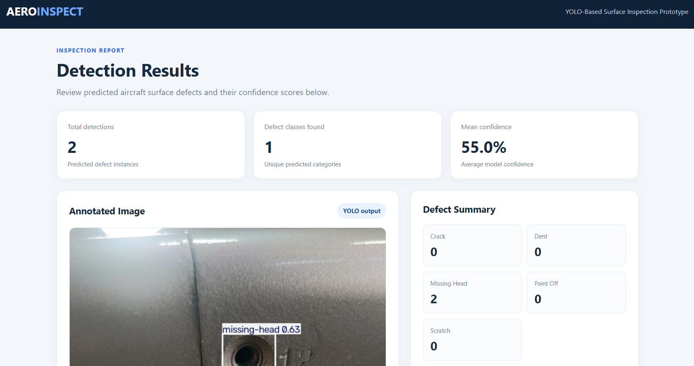
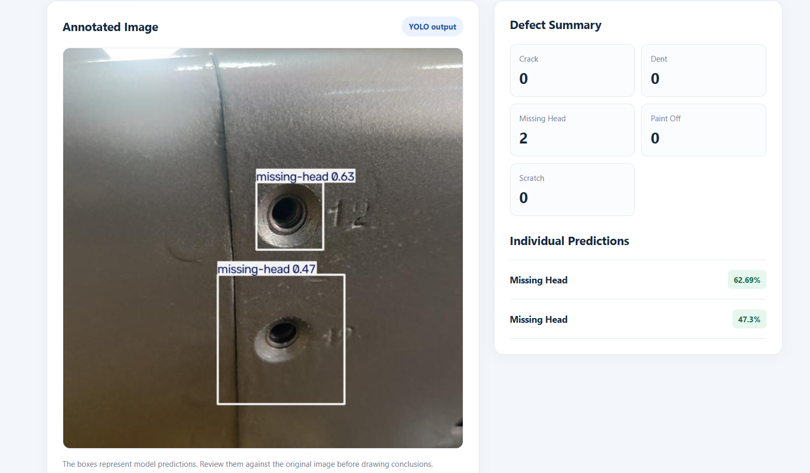
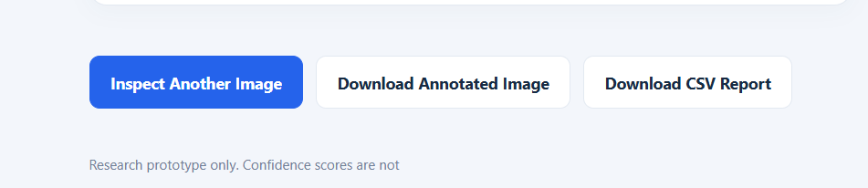
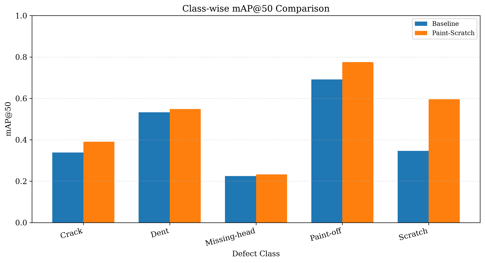
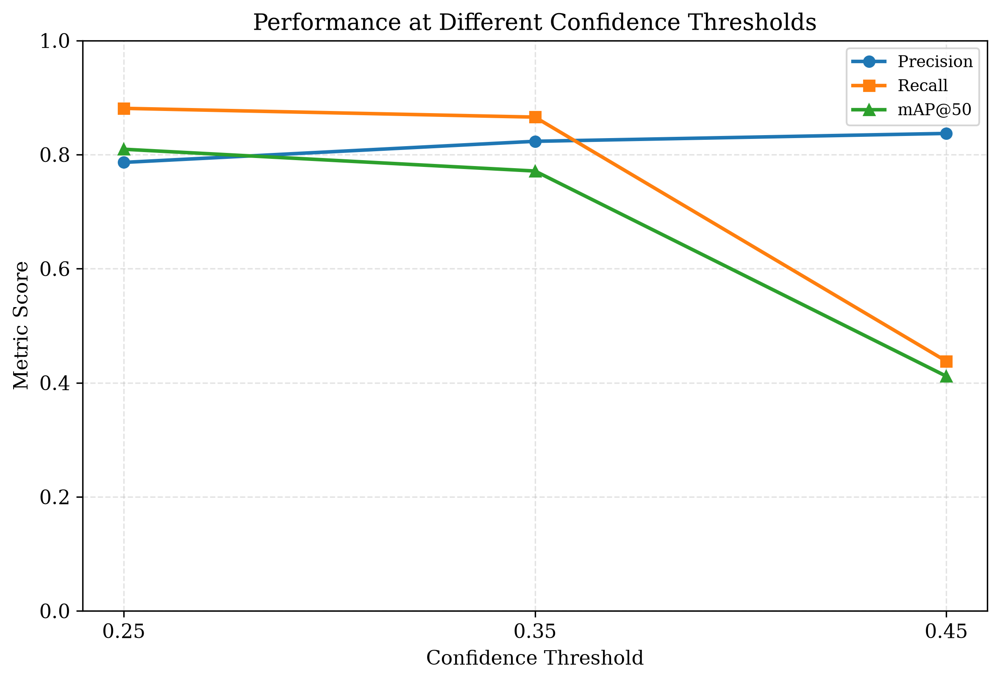
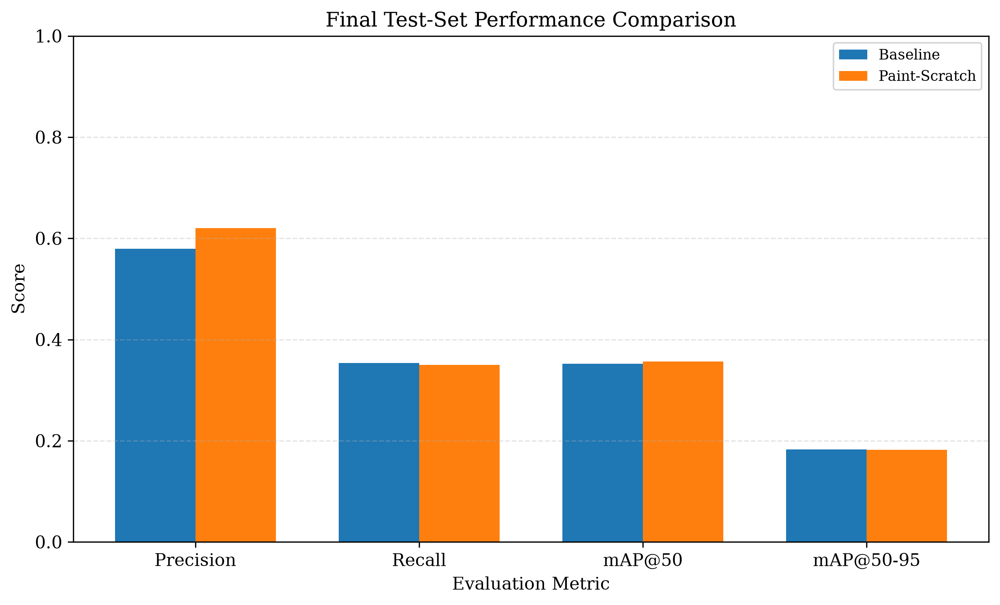

# AeroInspect — Aircraft Surface Defect Detection

## Overview

AeroInspect is a computer vision research prototype for detecting aircraft surface defects using a YOLO11n object detection model. The application allows users to upload aircraft surface images, view predicted defect locations, inspect confidence scores, and download annotated images and CSV inspection reports.

## Objectives

- Detect visible aircraft surface defects in uploaded images.
- Localize predicted defects using bounding boxes.
- Display predicted defect classes and confidence scores.
- Provide downloadable annotated images and inspection reports.
- Evaluate model performance using standard object detection metrics.

## Defect Classes

The model is configured to detect five defect categories:

- Crack
- Dent
- Missing-head
- Paint-off
- Scratch

## Technologies Used

- Python
- YOLO11n and Ultralytics
- Flask
- PyTorch
- Pillow
- HTML and CSS
- CSV report generation

## Application Features

- Upload aircraft surface images.
- Detect potential surface defects using a trained YOLO model.
- View annotated images with predicted bounding boxes.
- Review defect counts and confidence scores.
- Download annotated images.
- Download inspection results as a CSV report.

## Application Screenshots

### 1. Home Page

The home page allows users to select an aircraft surface image for inspection.



### 2. Detection Results

The results page displays the total detections, predicted defect categories, and mean confidence score.



### 3. Annotated Defect Detection

The annotated image displays the model's predicted defect locations and confidence scores.



### 4. Download Options

Users can inspect another image or download the annotated image and CSV report.



## Model Evaluation Results

The YOLO11n baseline and paint-scratch model were evaluated to investigate the effect of the paint-scratch training experiment on defect detection performance.

### 1. Class-Wise mAP@50

On the reported 51-image Aircraft_Skin_Defects_v1 test set, the paint-scratch model improved mAP@50 across all five defect classes.



### 2. Confidence Threshold Analysis

Three confidence thresholds were evaluated: 0.25, 0.35, and 0.45.

| Confidence threshold | Precision | Recall | mAP@50 | mAP@50–95 |
|---|---:|---:|---:|---:|
| 0.25 | 0.7863 | 0.8811 | 0.8094 | 0.5049 |
| 0.35 | 0.8233 | 0.8657 | 0.7712 | 0.4903 |
| 0.45 | 0.8371 | 0.4379 | 0.4115 | 0.3054 |

A threshold of 0.25 achieved the highest recall and mAP@50 among the three tested thresholds on this evaluation set. The 0.35 threshold produced higher precision, while the 0.45 threshold substantially reduced recall.



### 3. Final Test Comparison

The models were also evaluated on a separate test set containing 563 images.

| Metric | Baseline | Paint-Scratch Model |
|---|---:|---:|
| Precision | 0.5791 | 0.6205 |
| Recall | 0.3535 | 0.3496 |
| mAP@50 | 0.3523 | 0.3566 |
| mAP@50–95 | 0.1825 | 0.1819 |



On the 563-image test set, the paint-scratch model achieved slightly higher precision and mAP@50. Recall and mAP@50–95 were marginally lower than the baseline. Therefore, the results indicate a modest improvement in selected metrics rather than a consistent improvement across every metric.

**Evaluation note:** The 51-image evaluation and the separate 563-image test evaluation are different evaluation sets. Their results are reported separately and should not be directly compared as if they were the same experiment.

## How to Run

### 1. Install the required packages

```bash
pip install -r requirements.txt
```

Alternatively:

```bash
pip install flask ultralytics pillow
```

### 2. Ensure the model is available

Place the trained `best.pt` model at the path configured in `app.py`.

### 3. Start the application

Open a terminal in the project directory and run:

```bash
python app.py
```

### 4. Open the website

Navigate to:

`http://127.0.0.1:5000/`

Upload an aircraft surface image to view the detection results.

## Project Status

The Flask-based research prototype has been implemented. The application supports image upload, YOLO-based inference, annotated result visualization, and inspection report downloads.

The baseline and paint-scratch model evaluations have also been conducted on the reported test sets.

## Limitations

- Predictions may include false positives or missed defects.
- Confidence scores are model scores and do not guarantee prediction correctness.
- Performance may vary with image quality, lighting, surface appearance, and defect type.
- The evaluation results are limited to the datasets and experiments described above.
- The prototype is intended for research and demonstration. It is not certified for aircraft airworthiness decisions and does not replace qualified aircraft inspection.

## Future Improvements

- Evaluate performance on additional labelled and independently collected test images.
- Investigate false positives and missed detections, particularly for the missing-head class.
- Improve generalization across different lighting conditions and aircraft surfaces.
- Explore additional data augmentation and model optimization.
- Extend inspection reporting and project documentation.

## Repository Contents

- `app.py` — Flask application and model inference.
- `templates/` — HTML templates for the upload and results pages.
- `final_test_evaluation.py` — Final model evaluation script.
- `image_preprocessing.py` — Image preprocessing utilities.
- `prepare_dataset.py` — Dataset preparation script.
- `requirements.txt` — Python dependencies.
- `METHODOLOGY.md` — Project methodology.
- `best.pt` — Trained YOLO model weights.
- `classwise_map50.png` — Class-wise evaluation graph.
- `confidence_thresholds.png` — Confidence threshold analysis graph.
- `final_test_comparison.png` — Baseline versus paint-scratch comparison.
- Application PNG screenshots — Website interface and detection results.
